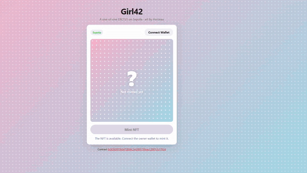

# Girl42 - TokenizArt

My own NFT on the Ethereum **Sepolia** testnet, made for the 42 School project *tokenizArt* (blockchain branch).

- **Contract:** `Girl42` (symbol `G42`), an ERC721 built on OpenZeppelin.
- **Supply:** exactly one token (ID `1`), mintable only by the contract owner.
- **Storage:** image and metadata are stored on IPFS through [Pinata](https://pinata.cloud).
- **Frontend:** a small web page to connect MetaMask, mint the token, and display it as read from the chain and IPFS.
- **Art:** drawn by [Horzeau](https://x.com/Horzeau).



*Connecting MetaMask, minting the token on Sepolia and loading the artwork from IPFS ([full-quality video](demo/girl42-demo.mp4)).*

## Repository layout

```
code/
  contracts/Girl42.sol      the smart contract
  tests/Girl42.test.js      Hardhat tests
  scripts/upload.js         uploads the image + metadata to IPFS
  scripts/fetch.js          reads the metadata back from IPFS
deployment/deploy.js        deploys the contract (and can mint)
images/                     the artwork and its generated metadata.json
website/                    minting page (index.html, app.js) + small Express backend (server.js)
documentation/              detailed docs
demo/                       demo of the minting page (GIF + MP4)
hardhat.config.js           Hardhat paths and Sepolia network
.env.example                template for the required environment variables
```

## Quick start

You need **Node.js 20+**, an [Infura](https://www.infura.io/) project (Sepolia endpoint), a [Pinata](https://pinata.cloud) account, and a wallet with some Sepolia ETH.

```bash
npm install
cp .env.example .env              # then fill in the values (see documentation/Deployment.md)

npx hardhat compile
npx hardhat test

node code/scripts/upload.js       # upload image + metadata to IPFS, put the metadata hash in .env
npx hardhat run --network sepolia deployment/deploy.js   # put the printed address in .env

node website/server.js            # backend on http://localhost:3000
npx http-server website           # frontend, open the printed URL
```

> `.env` must exist and contain `PRIVATE_KEY` and `INFURA_ENDPOINT` before **any** Hardhat command, including `compile` and `test`.

## Documentation

- [Deployment.md](documentation/Deployment.md) — environment variables and the full step-by-step: upload, deploy, mint, run the website.
- [Contract.md](documentation/Contract.md) — what the contract does, its functions, and what the tests cover.
- [NFTArt.md](documentation/NFTArt.md) — about the artwork and its artist.

## Why these tools

- **Ethereum + Solidity + ERC721** — the standard stack for NFTs; wallets and marketplaces support it out of the box.
- **OpenZeppelin** — audited ERC721 and `Ownable` implementations instead of writing them from scratch.
- **Sepolia** — a public testnet: same behaviour as mainnet, free ETH from faucets.
- **Hardhat** — compile, test and deploy from one tool. Its default paths are changed in `hardhat.config.js` to match the folder layout required by the subject.
- **Infura** — access to Sepolia without running a node.
- **IPFS / Pinata** — the image and metadata are content-addressed, so they can't be silently changed.

## Author

jrenault — 42 School. Artwork by [Horzeau](https://x.com/Horzeau).
